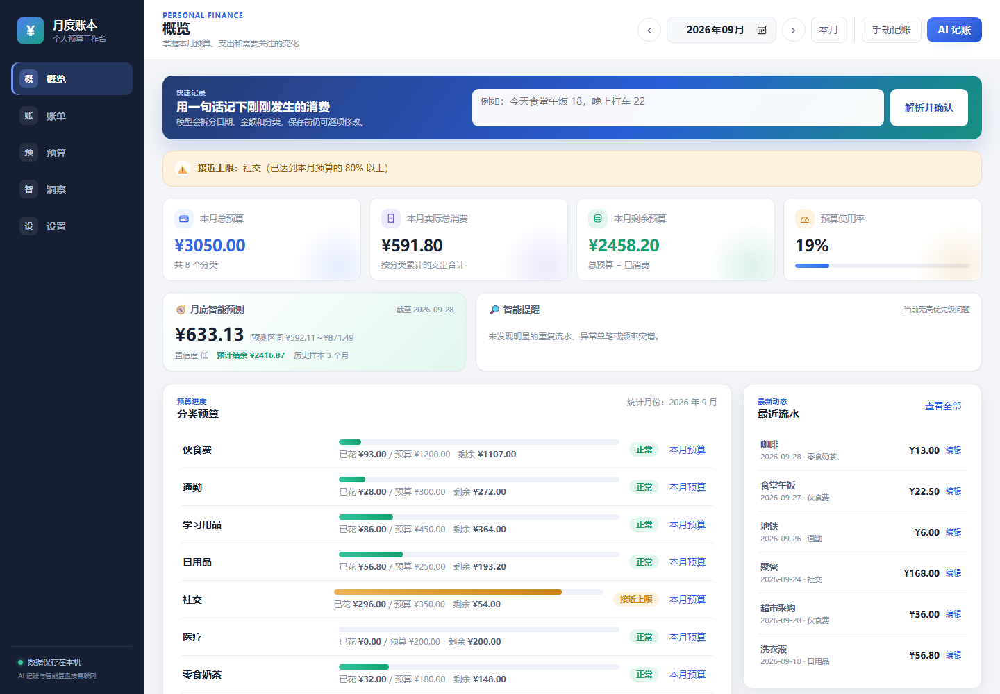
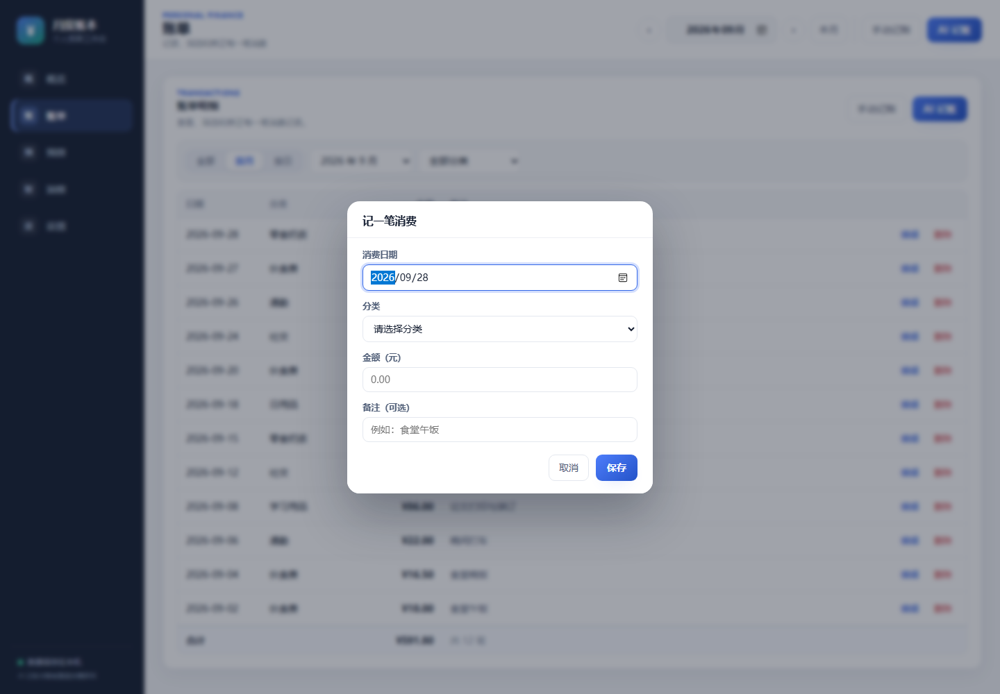
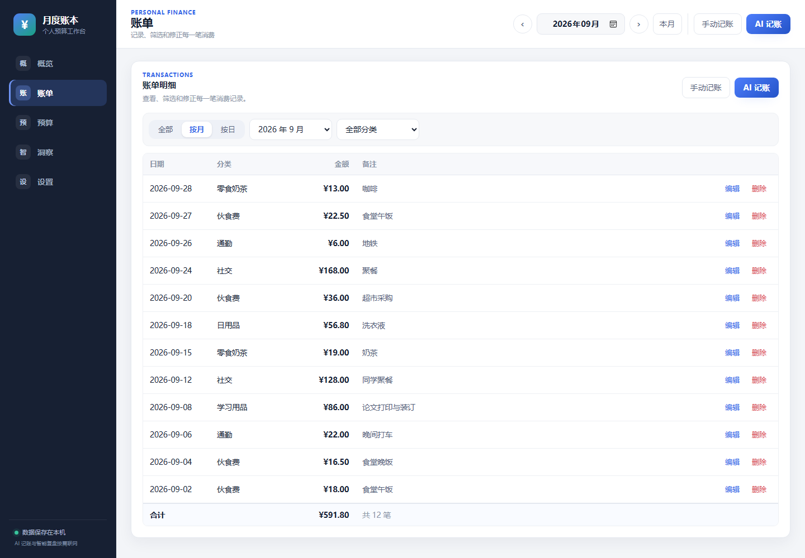
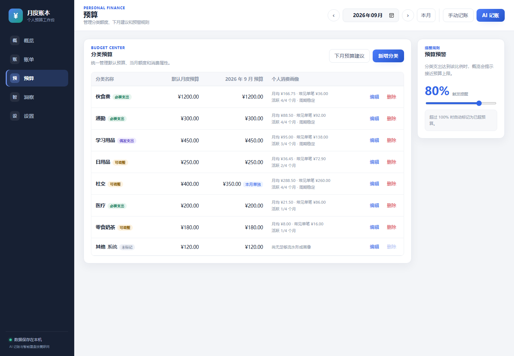
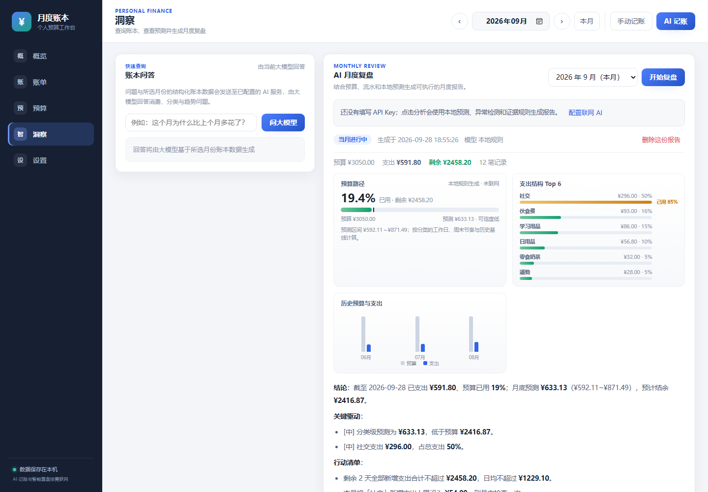
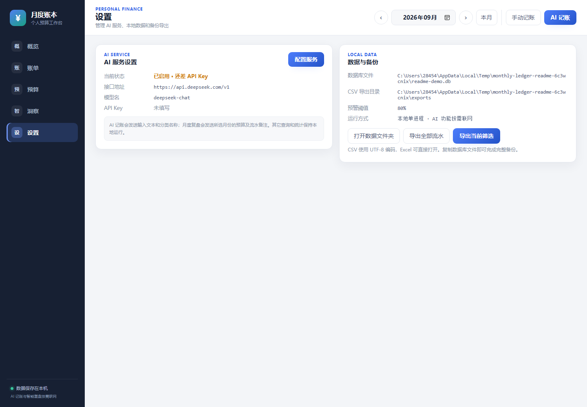

# 月度预算记账本

一款面向个人使用的 **Windows 本地记账软件**。核心思路很简单：先给各类消费设置每月预算，日常记录每一笔支出，随时查看已经花了多少、还剩多少。

> 无需注册账号，无需部署服务器。数据默认只保存在你的电脑中；只有你主动使用 AI 记账、账本问答或联网 AI 复盘时，程序才会调用你自己配置的模型接口。

> 本文截图由 `tests/generate_readme_screenshots.py` 自动生成。脚本会在系统临时目录创建独立的 `readme-demo.db` 并写入演示数据，不会读取或修改正式账本 `dataset/budget.db`。



## 适合谁

- 想按月控制生活费、学习支出或日常消费的人
- 不想把账单上传到云端，希望数据留在自己电脑里的人
- 希望看到“这个月还能花多少”，而不只是记录流水的人
- 需要分类预算、超支提醒、历史回顾和月底预测的人

## 功能介绍

### 月度总览

总览页集中显示本月总预算、实际消费、剩余预算和预算使用率，并按分类展示预算消耗进度。

- 分类状态：正常、接近上限、已超预算、未设预算
- 支出结构：自动生成分类占比图
- 历史对照：回顾最近有记录的月份
- 月底预测：根据当前消费速度估算月底支出区间
- 智能提醒：识别疑似重复流水、异常大额消费、消费频率突增等情况
- 月份切换：可查看任意历史月份，各月份独立统计


### 记一笔消费

每笔消费包含日期、分类、金额和可选备注。保存后，总览、预算余额和图表会立即更新。



还支持可选的 **AI 记账**：输入“今晚食堂 18，昨天打车 22”，模型会拆成多笔待确认记录。日期、分类、金额和备注都能修改，只有点击确认后才会写入账本。

> AI 记账需要自行配置兼容 OpenAI 格式的大模型接口。不配置 AI 也不影响手动记账和其它本地功能。

### 消费流水

账单页支持新增、编辑、删除和组合筛选：

- 全部：查看所有月份的记录
- 按月：查看指定月份
- 按日：只看某一天
- 按分类：只看某个消费分类
- 自动统计当前筛选结果的笔数和金额



### 分类与预算

可以为每个分类设置默认月度预算，默认预算会自动用于以后的月份。

- 新增、改名或删除分类
- 设置默认月度预算
- 为某一个月单独调整预算，不影响其它月份
- 标记消费属性：必要支出、可调整、偶发支出或未标记
- 调整“接近预算上限”的预警比例，默认是 80%
- 删除分类时，历史流水会转移到系统分类“其他”，不会直接丢失
- 根据历史消费生成下月预算建议



### 洞察与月度复盘

程序会先在本地计算消费特征、异常证据和月底预测。即使没有配置 AI，也可以生成完全离线的本地规则报告。

配置 AI 后，还可以使用：

- AI 月度复盘：总结问题、关键发现和下一步行动
- 账本问答：例如“这个月为什么比上个月多花了？”
- AI 记账：把自然语言拆成多笔消费记录
- 历史报告：保存、回看和删除以往生成的复盘

联网分析只在你主动点击相关按钮时发生。流水备注可能随分析数据一并发送给你选择的模型服务商，因此不要在备注里填写身份证号、银行卡号、密码等敏感信息。



### 本地数据与备份

所有账本数据默认保存在：

```text
dataset/budget.db
```

这是一个 SQLite 数据库文件，包含分类、预算、流水、设置和复盘报告。

- 每次启动时自动备份数据库
- 自动备份位于 `dataset/backups/`
- 最多保留最近 30 份自动备份
- 可导出全部流水或当前筛选结果为 CSV
- CSV 使用 UTF-8 BOM 编码，通常可直接用 Excel 打开



---

# 从零开始安装

下面按 Windows 10 / Windows 11 编写。即使电脑里没有 Python，也可以一步一步完成。

## 第 1 步：解压项目

如果拿到的是压缩包：

1. 右键压缩包，选择“全部解压缩”。
2. 把解压后的整个项目文件夹放到桌面或文档目录。
3. 不要只复制 `app.py`，`core`、`ui`、`dataset` 等文件夹必须和它放在一起。

项目目录正确时，至少能看到：

```text
cost/
├─ app.py
├─ 启动记账.bat
├─ core/
├─ ui/
└─ dataset/
```

## 第 2 步：安装 Python

1. 打开 Python 官方下载页：<https://www.python.org/downloads/windows/>
2. 下载 64 位 Python 3.10 或更高版本。
3. 双击安装程序。
4. **务必勾选安装窗口底部的“Add python.exe to PATH”。**
5. 点击“Install Now”，等待安装完成。

验证安装：

1. 按 `Win + R`。
2. 输入 `cmd`，按回车。
3. 输入：

```bat
python --version
```

如果显示类似 `Python 3.12.x` 或更高版本，说明安装成功。

如果提示“python 不是内部或外部命令”，先关闭所有命令行窗口再重新打开；仍然无效时，重新运行 Python 安装程序并确认勾选了“Add python.exe to PATH”。

## 第 3 步：安装依赖

本项目只需要手动安装一个主要依赖：`pywebview`。

1. 打开项目文件夹。
2. 点击文件资源管理器顶部的地址栏。
3. 输入 `cmd`，按回车。
4. 在弹出的黑色窗口中依次执行：

```bat
python -m pip install --upgrade pip
python -m pip install pywebview
```

看到 `Successfully installed` 即表示安装完成。

如果下载很慢，可使用国内镜像：

```bat
python -m pip install pywebview -i https://pypi.tuna.tsinghua.edu.cn/simple
```

## 第 4 步：确认 WebView2

界面使用 Microsoft Edge WebView2 渲染。Windows 10 和 Windows 11 通常已经自带，不需要额外安装。

如果启动后窗口全白，安装 Microsoft WebView2 Runtime：

<https://developer.microsoft.com/microsoft-edge/webview2/>

在页面中选择 Evergreen Runtime，安装完成后重启程序。

## 第 5 步：启动程序

回到项目文件夹，双击：

```text
启动记账.bat
```

正常情况下会出现一个黑色命令行窗口和一个“月度账本”操作窗口。

**黑色窗口不要关闭。** 它是程序本体，关闭后记账窗口也会退出。使用完毕后，直接关闭“月度账本”窗口即可。

如果双击后窗口一闪而过，在项目目录地址栏输入 `cmd`，回车后执行：

```bat
python app.py
```

错误信息会留在窗口中，可按本文后面的“常见问题”处理。

---

# 第一次使用：照着做即可

## 1. 先设置每月预算

1. 打开“预算”页面。
2. 点击某个分类右侧的编辑按钮。
3. 填写默认月度预算，例如伙食费 1000 元、通勤 200 元。
4. 根据需要选择消费属性。
5. 保存后，默认预算会自动沿用到以后月份。

如果只想修改某一个月，在“概览”中点击对应分类的“本月预算”。这种修改只影响当前选择的月份。

## 2. 记录第一笔消费

1. 点击“手动记账”或“记一笔”。
2. 选择消费日期和分类。
3. 输入金额。
4. 备注可以不填，也可以写“食堂午饭”“地铁”等简短说明。
5. 点击保存。

保存后回到概览，即可看到已花金额、剩余预算和图表变化。

## 3. 查看和修改流水

1. 打开“账单”页面。
2. 用“全部 / 按月 / 按日”和分类下拉框筛选。
3. 点击某条流水右侧的“编辑”进行修改。
4. 点击“删除”时会出现二次确认，确认后才会删除。

## 4. 定期检查

建议每周或每月做一次：

1. 在概览检查哪些分类接近上限或已经超支。
2. 查看月底预测是否超过总预算。
3. 到洞察页生成本地复盘；需要更自然的文字建议时再配置 AI。
4. 到设置页导出 CSV，或复制数据库文件做额外备份。

---

# AI 功能配置（可选）

不使用 AI 时可以完全跳过本节。

打开“设置” → “AI 服务设置” → “配置服务”，填写：

| 项目 | 填写内容 |
| --- | --- |
| 接口地址 | OpenAI 兼容接口的 `base_url`，通常以 `/v1` 结尾 |
| 模型名 | 服务商提供的模型名称 |
| API Key | 在对应服务商后台创建的密钥 |

建议先点击“测试连接”，成功后再保存。

API Key 会使用 Windows DPAPI 加密后保存到数据库，明文不会直接写入文件。加密结果与当前 Windows 用户绑定；换电脑或重装系统后，需要重新填写 Key。

一次联网月度复盘可能会调用模型多次，因此会产生相应的 token 消耗和服务商费用。

---

# 预算规则

- 默认月度预算会自动沿用到新月份。
- 某月单独设置的预算只影响该月。
- 上月剩余额度不会结转到下月。
- 已经结束的月份会归档当时生效的预算，修改默认预算不会改写历史结果。
- 支出达到预算 × 预警阈值时显示“接近上限”。
- 支出大于预算时显示“已超预算”。
- 预算为 0 但发生支出时显示“未设预算”。
- 系统分类“其他”不能删除或改名。

---

# 数据备份与恢复

## 完整备份（推荐）

关闭程序后，把下面这个文件复制到 U 盘、移动硬盘或其它安全位置：

```text
dataset/budget.db
```

恢复时先关闭程序，再用备份的 `budget.db` 覆盖项目中的 `dataset/budget.db`，然后重新启动。

## 使用自动备份恢复

每次启动程序前，旧数据库会自动复制到：

```text
dataset/backups/
```

恢复步骤：

1. 关闭程序。
2. 打开 `dataset/backups`。
3. 找到误操作之前的备份文件。
4. 把它复制到 `dataset` 文件夹。
5. 将复制后的文件改名为 `budget.db`，覆盖原文件。
6. 启动程序检查数据。

## 导出 CSV

“设置”页面可导出全部流水或当前筛选结果。CSV 适合用 Excel 查看和留档，但不包含所有程序设置和 AI 报告；需要完整恢复时，请备份 `budget.db`。

---

# 常见问题

## 双击启动后一闪而过

在项目目录地址栏输入 `cmd`，回车后执行 `python app.py`，根据留在屏幕上的错误继续排查。

## 提示 python 不是内部或外部命令

Python 没有安装，或安装时没有加入 PATH。重新安装 Python，并勾选“Add python.exe to PATH”。

## 提示 No module named webview

执行：

```bat
python -m pip install pywebview
```

安装包名称是 `pywebview`，但报错中的模块名称是 `webview`，这是正常的。

## 程序窗口是白屏

安装或修复 Microsoft Edge WebView2 Runtime，然后重启电脑和程序。

## AI 记账或账本问答不可用

依次检查 API Key、接口地址、模型名、联网 AI 开关、网络连接和账户余额。不配置 AI 时，手动记账、预算、统计、CSV、自动备份和本地规则复盘仍可正常使用。

## Excel 打开 CSV 乱码

请从程序内重新导出。程序导出的 CSV 使用 UTF-8 BOM；经过其它软件再次保存后，编码可能发生变化。

## 误删或误改数据

立即关闭程序，从 `dataset/backups/` 中选择误操作之前的备份，按“数据备份与恢复”章节覆盖 `dataset/budget.db`。

---

# 开发者说明

已安装 Python 和依赖时，在项目目录执行：

```bat
python app.py
```

运行测试：

```bat
python -m unittest discover -s tests -p "test_*.py"
```

重新生成 README 新版界面截图：

```bat
python tests\generate_readme_screenshots.py
```

该脚本会先设置独立的 `BUDGET_DB_PATH`，生成完截图后自动删除临时数据库和浏览器配置。

调试时建议使用独立数据库，避免改动正式账本：

```bat
set BUDGET_DB_PATH=D:\temp\test-budget.db
python app.py
```

## 项目结构

```text
cost/
├─ app.py                 程序入口，创建桌面窗口
├─ 启动记账.bat           Windows 双击启动脚本
├─ core/
│  ├─ api.py              前端调用接口
│  ├─ db.py               数据库初始化与自动备份
│  ├─ repo.py             分类、预算和流水的数据访问
│  ├─ service.py          统计、预警和 CSV 导出
│  ├─ intelligence.py     本地特征、异常检测和预测
│  ├─ memory.py           本地消费记忆与反馈
│  ├─ assistant.py        AI 记账、问答和预算助手
│  └─ ai.py               AI 配置、联网分析和本地报告
├─ ui/                    HTML、CSS 和 JavaScript 界面
├─ dataset/               数据库、自动备份和 CSV 导出
├─ docs/                  README 使用的界面截图
└─ tests/                 自动化测试
```

## 技术栈

- Windows 10 / Windows 11
- Python 3.10+
- pywebview + Microsoft Edge WebView2
- SQLite
- 原生 HTML、CSS、JavaScript
- 不启动本地 HTTP 服务，不占用端口
- 普通记账功能不需要联网
